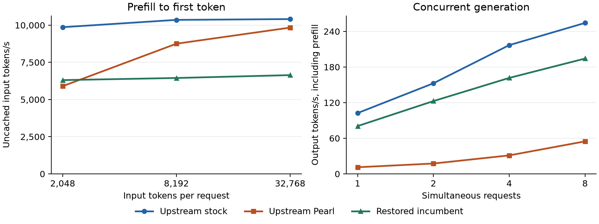

# DeepSeek V4.1 Flash throughput on four RTX PRO 6000s

At eight simultaneous requests the servers delivered **254.3 output tokens/s on upstream stock**, **54.8 with Pearl** and **194.2 on the restored incumbent**, including prompt processing. Each request consumed 2,048 input tokens and generated 128 output tokens.

For a single stream with 2,048 input and 256 output tokens, Pearl’s median client decode rate was 9% of upstream stock and 11% of the restored incumbent.

Pearl retained 59%, 84% and 95% of stock’s server prefill throughput at 2,048, 8,192 and 32,768 input tokens, respectively.

The November runs use the 1017 checkpoint, tensor and expert parallelism of four, and DSPARK block size five. Upstream stock uses the checkpoint’s native projection and decode graphs. The Pearl profile uses a calibrated INT7 projection for target layer zero’s `attn.wo_b`, eager execution, a local verifying peer and watched idle miners. The comparison includes the cost of changing execution modes and proof handling.

Both rebuilt profiles use `sm120/production-reconstruction` at `481e8e66504c`, built on `sgl-project/sglang main` at `c64f2256d583` (2026-11-24T00:00:36Z). The deployment branch for this run was `sm120/pearl-upstream-deployment`. [Build and profile details](full-run.json)

## Single-request prefill and decode

Each native request forces 256 output tokens at temperature zero. Rows report medians across the counted trials. Client prefill divides fresh input tokens by time from HTTP send to the first token-bearing event. The client timer starts after input tokenization. Server prefill uses the scheduler’s forward-entry and prefill-finished timestamps where present. Server decode uses reported decode throughput. Client decode counts tokens after the first streaming event through the final event, allowing DSPARK to bundle several tokens. Accepted length is tokens per speculative verification.

| Profile | Input tokens | Trials | Cached tokens | First token (s) | Client prefill (tok/s) | Server prefill (tok/s) | Server decode (tok/s) | Client decode (tok/s) | Accepted length |
| --- | --- | --- | --- | --- | --- | --- | --- | --- | --- |
| Upstream stock | 2,048 | 3 | 0 | 0.208 | 9,864 | 10,282 | 118.0 | 118.0 | 2.42 |
| Upstream Pearl | 2,048 | 3 | 0 | 0.347 | 5,897 | 6,087 | 10.8 | 10.8 | 2.35 |
| Restored incumbent | 2,048 | 3 | 0 | 0.325 | 6,306 | 6,465 | 97.9 | 97.9 | 2.33 |
| Upstream stock | 8,192 | 3 | 0 | 0.791 | 10,356 | 10,525 | 118.5 | 118.5 | 2.44 |
| Upstream Pearl | 8,192 | 3 | 0 | 0.936 | 8,753 | 8,888 | 11.8 | 11.8 | 2.49 |
| Restored incumbent | 8,192 | 3 | 0 | 1.270 | 6,448 | 6,498 | 94.9 | 94.9 | 2.27 |
| Upstream stock | 32,768 | 3 | 0 | 3.148 | 10,409 | 10,480 | 129.6 | 129.6 | 2.69 |
| Upstream Pearl | 32,768 | 3 | 0 | 3.331 | 9,836 | 9,921 | 10.9 | 10.9 | 2.39 |
| Restored incumbent | 32,768 | 3 | 0 | 4.934 | 6,641 | 6,664 | 109.2 | 109.1 | 2.61 |

First-use latency varied across trials. Upstream stock at 2,048 input tokens took 5.35 s on the first trial and 0.21 s on the median of the remaining 2. Upstream Pearl at 2,048 input tokens took 39.49 s on the first trial and 0.35 s on the median of the remaining 2. The table includes these first trials.

## Concurrent generation

Each synchronized batch sends 2,048 input tokens per request and forces 128 output tokens per request. Aggregate throughput divides all generated tokens by elapsed time from the first send to the last response. First-token latency is the median across requests in that batch. Each profile uses the same token IDs for a given trial.

| Requests | Upstream stock tok/s | Upstream stock first token (s) | Upstream Pearl tok/s | Upstream Pearl first token (s) | Restored incumbent tok/s | Restored incumbent first token (s) |
| --- | --- | --- | --- | --- | --- | --- |
| 1 | 102.4 | 0.208 | 11.2 | 0.345 | 80.5 | 0.311 |
| 2 | 152.6 | 0.348 | 17.4 | 1.258 | 122.6 | 0.532 |
| 4 | 216.9 | 0.626 | 31.1 | 2.132 | 161.6 | 0.938 |
| 8 | 254.3 | 1.213 | 54.8 | 3.895 | 194.2 | 1.781 |

## Prefix reuse

Two consecutive requests share 8,192 leading tokens and have distinct 16-token suffixes. Each generates one token.

| Profile | Request | Input tokens | Cached tokens | First token (s) | Server prefill (s) |
| --- | --- | --- | --- | --- | --- |
| Upstream stock | cold | 8,208 | 0 | 0.860 | 0.851 |
| Upstream stock | warm | 8,208 | 7,936 | 0.139 | 0.129 |
| Upstream Pearl | cold | 8,208 | 0 | 0.877 | 0.864 |
| Upstream Pearl | warm | 8,208 | 7,936 | 0.137 | 0.125 |
| Restored incumbent | cold | 8,208 | 0 | 1.519 | 1.509 |
| Restored incumbent | warm | 8,208 | 8,192 | 0.232 | 0.221 |

## Long handbook generation

The streamed Responses workload uses temperature 1.0 and top-p 0.95. The output cap is listed for each run. TTFT ends at the first nonempty text delta. Client decode uses (total output tokens − 1) divided by time from first text to the terminal event. November server decode uses an attributable scheduler time-per-output-token observation, or the equivalent server first-token and end-to-end latency observations on the original deployment. Long natural generations have different output lengths. September used an earlier checkpoint at 250 W, NVMe Engram, a 409,600-token window and a static memory fraction of 0.85.

All three November profiles used identical prompt hashes, token counts, sampling settings and output caps. Their observed output lengths are recorded below.

| Profile | Input tokens | Cached | Output tokens | Output cap | First text (s) | Wall (s) | Client prefill (tok/s) | Client decode (tok/s) | Server decode (tok/s) | Accepted length |
| --- | --- | --- | --- | --- | --- | --- | --- | --- | --- | --- |
| September 15 | 32,788 | 0 | 6,091 | 8,192 | 15.547 | 98.92 | 2,109 | 73.0 | 73.1 | 2.48 |
| September 15 | 131,388 | 0 | 8,190 | 8,192 | 39.616 | 151.09 | 3,317 | 73.5 | 73.5 | 2.48 |
| September 15 | 200,304 | 0 | 8,190 | 8,192 | 46.174 | 144.65 | 4,338 | 83.2 | 83.3 | 2.78 |
| Upstream stock | 32,779 | 0 | 8,192 | 8,192 | 3.452 | 76.97 | 9,495 | 111.4 | 111.4 | — |
| Upstream stock | 131,387 | 0 | 512 | 512 | 13.610 | 18.36 | 9,654 | 107.6 | 107.6 | — |
| Upstream stock | 200,305 | 0 | 512 | 512 | 20.989 | 25.94 | 9,544 | 103.2 | 103.2 | — |
| Upstream Pearl | 32,779 | 0 | 8,192 | 8,192 | 5.329 | 784.88 | 6,151 | 10.5 | 10.5 | — |
| Upstream Pearl | 131,387 | 0 | 512 | 512 | 13.910 | 62.16 | 9,445 | 10.6 | 10.6 | — |
| Upstream Pearl | 200,305 | 0 | 512 | 512 | 21.241 | 70.46 | 9,430 | 10.4 | 10.4 | — |
| Restored incumbent | 32,779 | 0 | 8,190 | 8,192 | 5.616 | 92.87 | 5,837 | 93.8 | 93.9 | — |
| Restored incumbent | 131,387 | 0 | 510 | 512 | 21.826 | 26.65 | 6,020 | 105.4 | 105.5 | — |
| Restored incumbent | 200,305 | 0 | 510 | 512 | 33.443 | 39.14 | 5,989 | 89.3 | 89.3 | — |

## Near-full-window replay

The November requests replay the September 16 payload byte for byte. This short answer tests prefill and first-text latency. Server prefill uses the reported scheduler interval. Client prefill divides uncached input by time to first text. The September baseline logged 272 recoverable allocator retries with RAM Engram and automatic KV sizing.

| Profile | Input tokens | Cached | Output tokens | First text (s) | Wall (s) | Server prefill (s) | Server prefill (tok/s) | Client prefill (tok/s) | Answer 42 |
| --- | --- | --- | --- | --- | --- | --- | --- | --- | --- |
| September 16 | 524,177 | 0 | 2 | 103.413 | 103.924 | 100.393 | 5,221 | 5,069 | Pass |
| Upstream stock | 524,177 | 0 | 2 | 57.493 | 57.615 | 55.988 | 9,362 | 9,117 | Pass |
| Upstream Pearl | 524,177 | 0 | 2 | 58.194 | 58.511 | 56.614 | 9,259 | 9,007 | Pass |
| Restored incumbent | 524,177 fixture | — | — | — | — | — | — | — | Failed |

The restored original deployment received the same 524,177-token fixture. All four tensor-parallel ranks reported an out-of-memory error in the indexer, the stream closed before a terminal response, and Docker restarted the service. The failed row reports the fixture length only. This prevented a completed throughput or first-token measurement. [Failed replay evidence](window-incumbent.json)

Physical GPU telemetry reached 97,092 MiB (94.82 GiB) used on one board during the approximate outer client-process interval of the failed replay. [Hardware measurements](hardware-throughput.json)

## Incremental cost of the mining job

Three cold-prefix pairs used the same eager server, calibrated target-layer weights, four direct workers, 2,048-token inputs and 128 forced output tokens. The first series used an active local proof job. The second used the integer fallback after the peer stopped. The run order was fixed. [Active-job receipts](eager-job.json) · [Peer-off receipts](eager-plain.json)

The freshly launched eager process first served a disjoint 2,048-input, 128-output warm-up with the job active.

| Pair | Job first token (s) | Job client decode (tok/s) | Job accepted length | Peer off first token (s) | Peer off client decode (tok/s) | Peer off accepted length | Same output IDs |
| --- | --- | --- | --- | --- | --- | --- | --- |
| 0 | 0.375 | 10.2 | 2.29 | 0.352 | 13.1 | 2.84 | No |
| 1 | 0.401 | 9.4 | 2.25 | 0.351 | 10.3 | 2.33 | No |
| 2 | 0.421 | 10.4 | 2.37 | 0.400 | 10.5 | 2.37 | No |

Across matched pairs, the median change in client decode rate with the job active was -8.6% (range -22.1% to -0.4%). Output token IDs matched in 0 of 3 pairs.

Different generated sequences can change speculative acceptance and decode throughput. The paired changes include that effect alongside the cost of projection and proof handling.

Active GPU samples during these two series showed 13,365 MHz memory clocks under a 280 W per-card cap. [Hardware measurements](hardware-throughput.json)

## Model output checks

Seven short greedy fixtures forced 16 tokens each. The table counts exact output-token matches for one natural prompt and six synthetic token sequences. The separate arithmetic check expects 42. These fixtures cover deterministic behavior on the sampled inputs. Broader model quality remains unmeasured.

| Comparison | Exact token sequences | Natural text | Arithmetic |
| --- | --- | --- | --- |
| [Upstream Pearl vs upstream stock](candidate-pearl.json) | 4/7 | Matched | Matched |
| [Upstream stock vs original deployment](candidate-stock.json) | 5/7 | Matched | Matched |
| [Restored vs pre-outage original deployment](incumbent-unlocked.json) | 4/7 | Matched | Matched |

The original software also produced different greedy IDs across its two launches. The short trials and the longer job-on/off comparison show output variation. Attributing a change in model quality would require broader evaluation.

Both rebuilt profiles passed the full-model startup checks for text, structured JSON, tool continuation and vision. [Startup check results](full-run.json)

## Mining during generation and between requests

Across 8 of 8 traced requests the four direct miners were active before HTTP send, drained during inference, held their work cursors stationary, and resumed. The table gives the observed range and median. These eight trials establish no bound on future tail latency. [Handoff observations](candidate-handoff.json)

| Interval | Observations | Min (ms) | Median (ms) | Max (ms) |
| --- | --- | --- | --- | --- |
| HTTP send to observation of all four miners drained | 8 | 4.792 | 5.502 | 6.031 |
| First miner release to observed GPU re-entry on all four boards | 8 | 0.258 | 0.284 | 3.339 |
| HTTP return to last observed GPU re-entry | 8 | -0.241 | 3.585 | 22.188 |
| Individual worker release to its GPU re-entry | 32 | 0.133 | 0.189 | 0.221 |

The broker observer polled nominally every millisecond with a maximum gap of 6.05 ms. A negative HTTP-return interval means the GPU had re-entered mining before the client observed the response. Worker release-to-entry comes from the worker observing its GPU-mapped start flag.

The easy-target local peer independently verified **340 distinct proofs** during those 8 full-model calls. Of these, 32 came from prefill and 308 from speculative target verification during generation, across all 4 tensor-parallel ranks. [Per-rank proof evidence](candidate-proofs.json)

After the 524,177-token request completed, GPU0 and GPU2 reached the 92 °C worker limit on resuming direct mining. Fleet cleanup removed the broker socket. The next inference admission failed, and cooldown and an operator restart were required. Existing model ranks held stale broker connections after a fresh fleet started. [Worker thermal and recovery evidence](mining-evidence.json)

Including startup, the easy peer retained 472 distinct hashes in 472 submissions. On the harder job the first 16 retained verifier-positive submissions contained 13 distinct hashes and 3 exact resubmissions. These local measurements establish neither paid external pool credit nor inference TH/s. [Peer evidence](mining-evidence.json)

Only the target model’s first-layer output projection participates. The table divides its observed real-row multiply-accumulates across all four ranks by elapsed client time for each phase. The percentage compares that logical MAC rate with the measured four-worker idle rate. Prefill ends at the first text delta, and target verification spans first text to terminal status. The counters include calls eligible by shape even when a pool job or proof queue may be unavailable. [Projection counts and dimensions](projection-work.json)

| Input tokens | Output tokens | Prefill TMAC/s | Prefill % of idle | Verify TMAC/s | Verify % of idle |
| --- | --- | --- | --- | --- | --- |
| 32,779 | 8,192 | 0.25797 | 0.021456 | 0.00113 | 0.000094 |
| 131,387 | 512 | 0.39617 | 0.032950 | 0.00110 | 0.000091 |
| 200,305 | 512 | 0.39553 | 0.032897 | 0.00113 | 0.000094 |
| 524,177 | 2 | 0.37780 | 0.031422 | 0.00159 | 0.000132 |

Over 150.21 seconds of sampled intervals between inference requests, the four direct miners sustained **1.202 PMAC/s**. The last F2Pool supervisor snapshot before shutdown reported 1.237 PMAC/s in summed worker lifetime averages, putting the offline workers at **97.2%** of that local rate. An older F2Pool snapshot measured 1.281 PMAC/s, giving a ratio of 93.8%. The snapshots and experimental workers used different clock settings and time windows. [Idle mining measurements](mining-evidence.json)

## Hardware and coverage

VRAM and clock ranges below are snapshots across all four devices at the start and end of each native series. Power is the configured per-card limit. The snapshots include other GPU processes. The November performance runs use 280 W per card. The 250 W September results used a different checkpoint and memory configuration.

| Profile | Power limit (W) | Memory clock (MHz) | SM clock (MHz) | VRAM used per GPU (GiB) | KV pool tokens |
| --- | --- | --- | --- | --- | --- |
| Upstream stock | 280 | 13,365 | 2,182–2,347 | 84.29–84.91 | 4,057,344 |
| Upstream Pearl | 280 | 13,365 | 2,302–2,355 | 83.87–86.48 | 3,745,024 |
| Restored incumbent | 280 | 13,365 | 2,122–2,310 | 87.27 | 4,121,856 |

Before the outage the original service had a 3,486,976-token KV pool. On restart, with the paid miner offline and the original GPU memory cap absent, the same deployment allocated 4,121,856 tokens (+18.2%). The restored throughput figures use that larger pool. [Pre-outage profile](incumbent.json) · [Restored profile](incumbent-native.json)

After the 524K failure, the original container restarted, passed all four startup checks and returned 42 on a fresh chat request. Its 96,316 MiB per-card limits had reset. The paid F2Pool service was offline at the end of the benchmark and restoring those limits required administrator access. The November 21 launch applied them during weight loading, before KV allocation. [Deployment recovery record](deployment-restoration.json)

The rebuilt service cgroups peaked at 207.3–207.9 GiB anonymous and 0.0 GiB unevictable, reaching 365.0 GiB charged including file cache under a 365 GiB cap. The original Docker scope separately recorded 189.1 GiB unevictable. [Host memory accounting](full-run.json)

Two-second telemetry sampled active devices during timed native requests. The memory and SM clock ranges cover samples with nonzero utilization. Peak VRAM is the range of the four board maxima observed during recorded requests. A positive leading gap means telemetry began after the benchmark. [Hardware measurements](hardware-throughput.json)

| Profile | Active GPU samples | Power limit (W) | Active memory clock (MHz) | Active SM clock (MHz) | Peak VRAM per GPU (GiB) | Leading gap (s) |
| --- | --- | --- | --- | --- | --- | --- |
| Upstream stock | 96 | 280 | 13,365 | 1,987–2,302 | 86.51–86.52 | 0.0 |
| Upstream Pearl | 560 | 280 | 13,365 | 1,980–2,355 | 86.48 | 14.5 |
| Restored incumbent | 116 | 280 | 13,365 | 2,025–2,317 | 87.27 | 0.0 |

Across all three native and long-handbook series, every active board sample had a 13,365 MHz memory clock and a 280 W cap.

| Profile | Native stream | Long handbook | Near-full window | Prefix reuse |
| --- | --- | --- | --- | --- |
| Upstream stock | [complete](stock-native.json) | [complete](stock-handbook.json) | [complete](window-stock.json) | [complete](stock-prefix.json) |
| Upstream Pearl | [complete](pearl-native.json) | [complete](pearl-handbook.json) | [complete](window-pearl.json) | [complete](pearl-prefix.json) |
| Restored incumbent | [complete](incumbent-native.json) | [complete](incumbent-handbook.json) | [failed](window-incumbent.json) | [complete](incumbent-prefix.json) |

A dash marks an unavailable metric or receipt. Trial counts are small and include any first-use costs during the series. Clock, load and accepted length can all affect these rates. [Native benchmark](throughput.py) · [Full-window replay](full_window.py) · [September handbook](../../../../bench/deepseek-v4.1-flash_TP4_sglang/BENCHMARK-LONG-TPS-2026-09-15.md) · [September full window](../../../../bench/deepseek-v4.1-flash_TP4_sglang/BENCHMARK-FULL-PREFILL-RESTORED-085-2026-09-16.md)

Regenerate from this directory with `python3 report_performance.py` in a Python environment with Matplotlib. Use `--no-plot` for a standard-library-only Markdown build.
