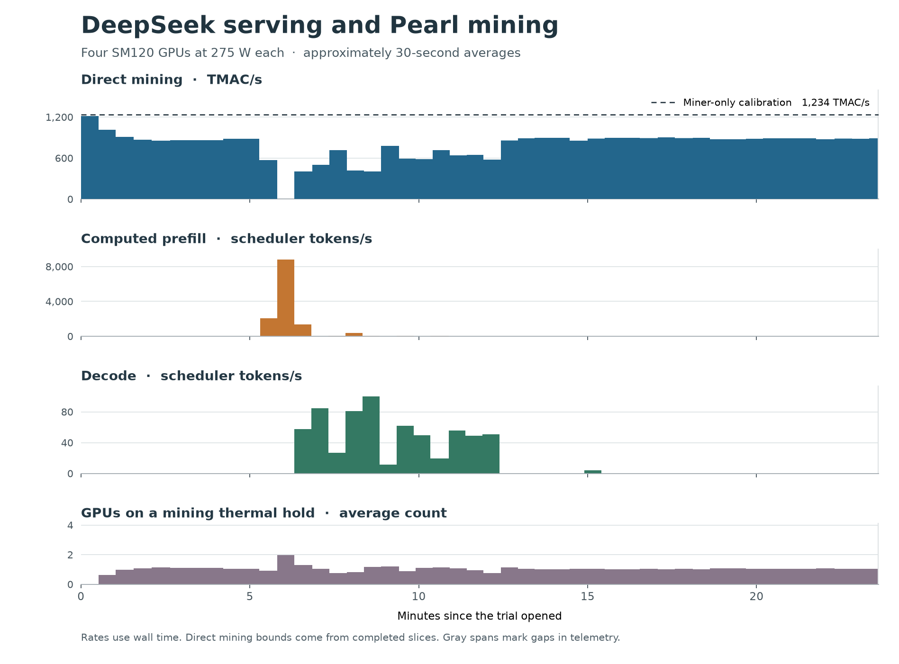

# Joined DeepSeek and F2Pool real-use trial

The user ended the trial after **23 minutes 36.7 seconds**, from 8:51:03 p.m. to 9:14:40 p.m. Pacific on November 23, 2026. Thirty streaming calls reached the usual `/v1/responses` endpoint. All returned HTTP 200. No requests were active at either boundary. The server used the full DeepSeek-V4.1-Flash-1017 checkpoint with TP4/EP4, DSPARK and full decode CUDA graphs. Each of the four GPUs retained its 275 W limit. [Measurements](measurements.json)

## Inference

| Metric | Observed |
|---|---:|
| Input tokens | 11,660,207 |
| Fresh / cached input tokens | 392,111 / 11,268,096 |
| Cache-hit fraction of input | 96.64% |
| Generated tokens | 19,732 |
| Fresh prefill rate during native prefill forward time | 7,584 tokens/s |
| Decode rate over native inter-token intervals | 181.0 tokens/s |
| Time to first token, median / p95 | 264 / 585 ms |
| Longest time to first token | 46.44 s |

The first request computed **366,847 fresh tokens** and accounts for the 46.44-second cold start to generation. Every subsequent request produced its first token within 586 ms. The first-token histogram advanced by one observation per sample with new observations, so the median and nearest-rank p95 can be recovered from its cumulative sum. Decode throughput uses 19,702 inter-token intervals, collectively lasting 108.87 seconds. The trial did not include a paired miner-disabled replay of these requests. [First-token timing](first-token-latency.json)

## Mining

F2Pool acknowledged **328 of 328 direct mining submissions** within the measured window, with **zero rejections**. GPUs 0–3 contributed 72, 85, 82 and 89 acknowledged shares respectively. The exact interval uses matched pool replies and their monotonic timestamps. GPU 2 received one additional acknowledgement 194 ms before the window opened, between the baseline sample and the exact start. It is excluded from 328. These are pool acknowledgements. Coin payout was not measured.

During requests, SGLang's layer-zero `attn.wo_b` multiply supplies both the activation consumed by the rest of the model and the Pearl tickets. The four SGLang ranks scanned **69,299,200 prefill tickets** and **11,956,800 decode tickets**. No inference ticket won at the assigned targets, so there were zero inference submissions and zero pool-accepted inference shares. The sampled targets and verified work imply about **0.38–0.75%** probability of at least one inference share in this workload.

| Inference phase | Verified projection work | Work rate during the corresponding serving phase | Fraction of historical pure mining rate |
|---|---:|---:|---:|
| Prefill | 16.1653–16.1658 trillion MACs | 0.313 TMAC/s | 0.0253% |
| Decode | 0.7836 trillion MACs | 0.00720 TMAC/s | 0.00058% |

The mixed prefill shapes provide a narrow bound on MACs. Decode work reconciles exactly. Rates use the server's cumulative prefill-forward and inter-token durations. Combined inference work was equivalent to **13.74 ms** of the four-card miner at its historical **1,233.67 TMAC/s** calibration. [Miner-only calibration](../../../direct-calibration.json)

Dedicated `bpm` workers remained resident alongside each SGLang rank and yielded the GPU on request admission. The broker allowed direct mining for **20m 53s** and reserved the GPUs for serving for **2m 44s**. During permitted idle time, direct work averaged **892–893 TMAC/s**, about **72.3%** of the miner-only calibration. Including time spent serving, direct work averaged **788–789 TMAC/s**, or **63.9%**. During the **31.6 seconds** of sampled intervals when all four workers stayed continuously available, the fleet delivered **1,212–1,213 TMAC/s**, or **98.2–98.3%** of the calibration.

## Handoff and cooling

| Transition | Observations | Median | p95 |
|---|---:|---:|---:|
| Request demand to all four direct miners parked | 30 | 1.77 ms | 2.04 ms |
| Broker idle to first eligible GPU mining | 13 | 0.62 ms | 0.71 ms |
| Broker idle to all immediately eligible GPUs mining | 13 | 0.69 ms | 0.96 ms |
| Broker idle to all four GPUs mining, including cooling waits | 13 | 476 ms | 1,155 ms |

The high-resolution return-to-mining observer covered 13 of the 30 transitions. Nine of those included a confirmed cooling hold. A worker could resume direct mining as soon as its own serving and thermal holds cleared.

The trial paused each direct miner at 88°C and resumed it at 84°C. GPUs 0 and 2 accumulated **12m 24s** and **11m 22s** on thermal holds respectively. The highest sampled temperature was **91°C**. Neither the software nor hardware thermal-slowdown counter increased. Four-card GPU energy was approximately **0.376 kWh**, averaging **956 W** total.

During the **last 84 seconds**, all sampled while inference was idle, per-card GPU busy time averaged **38.2%, 95.0%, 44.3% and 94.8%**. The fleet average was **68.1%**. GPUs 0 and 2 cycled on their cooling holds while GPUs 1 and 3 remained busy. The utilization sample covers 5.93% of the trial. [Utilization measurements](utilization.json)

## Restoration

The ingress drained, the trial miners and timers stopped, and the original container restarted with the same identity, full decode graphs and 4,121,856-token serving capacity. Four fresh native startup checks passed. A subsequent streaming request to the original `/v1/responses` returned HTTP 200 and the correct arithmetic answer. This check was outside the trial. The pre-existing standalone paid service was offline before and after the experiment. [Restoration receipt](restoration.json)
